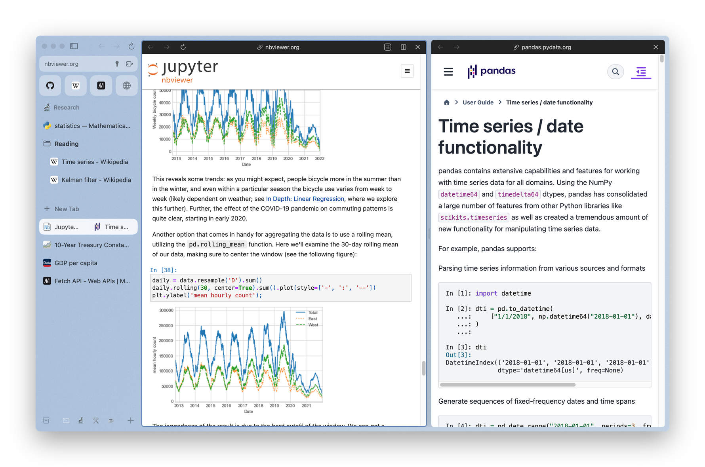
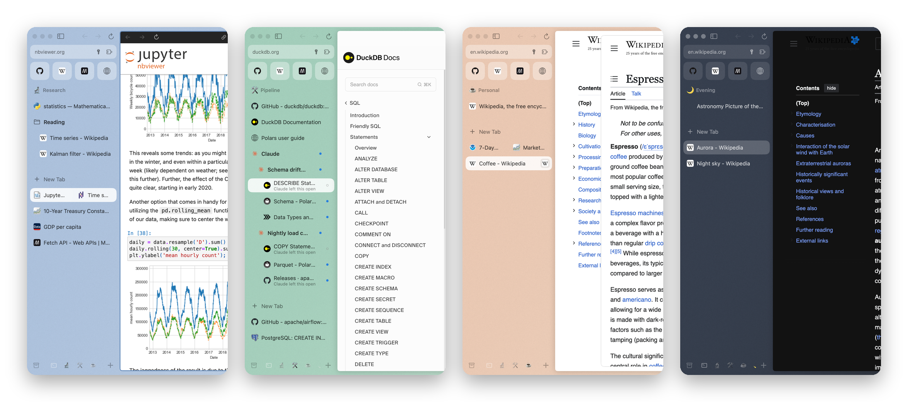
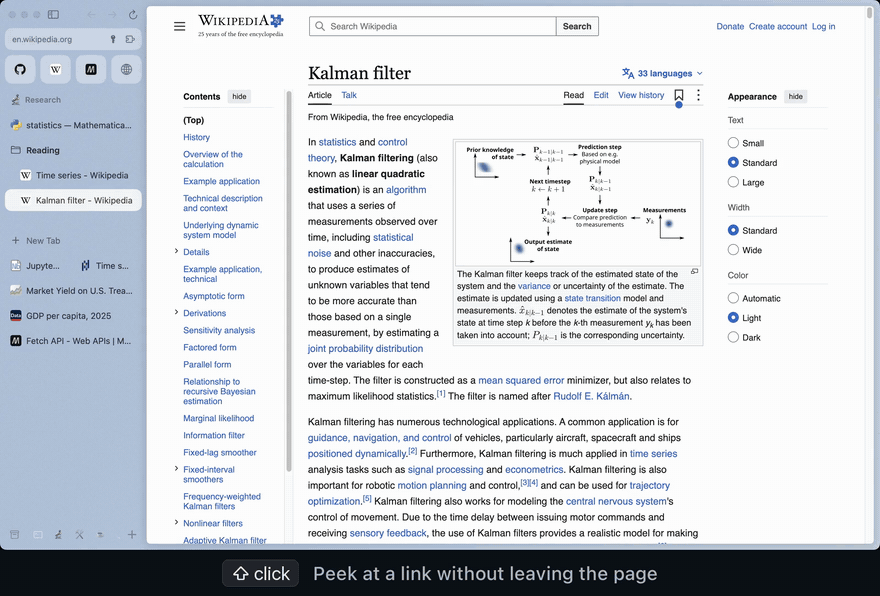
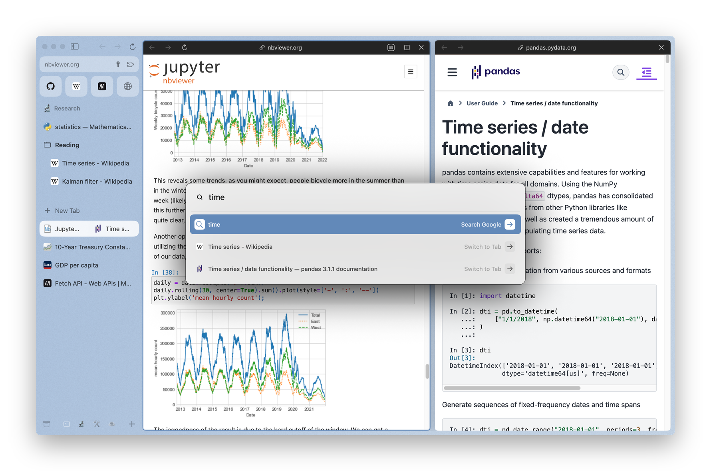
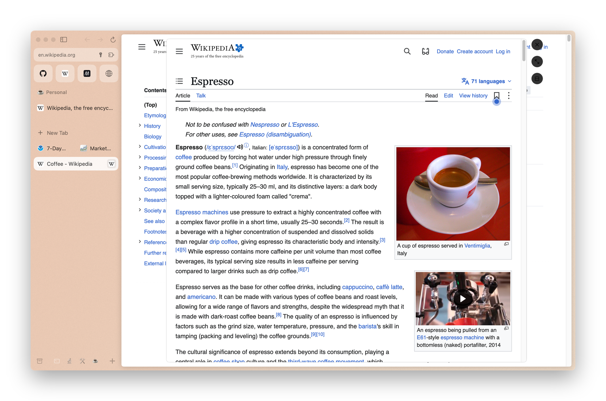
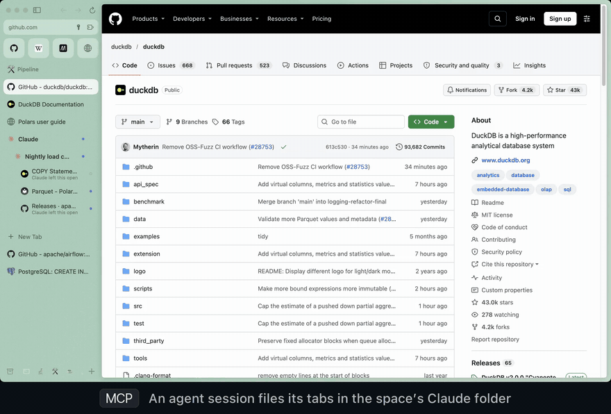
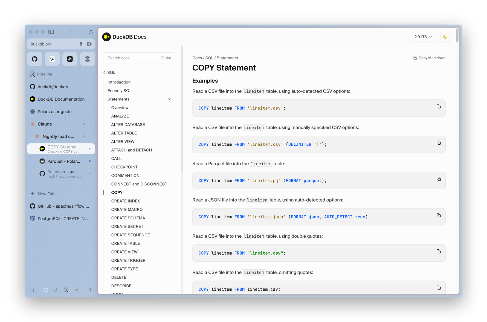
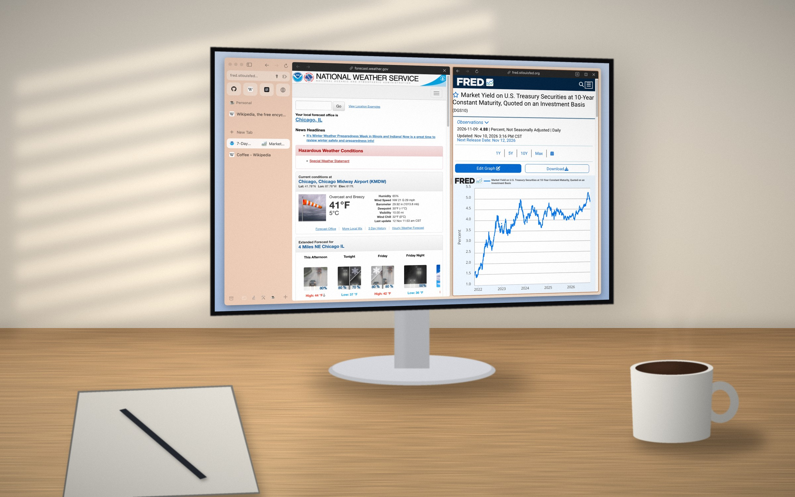
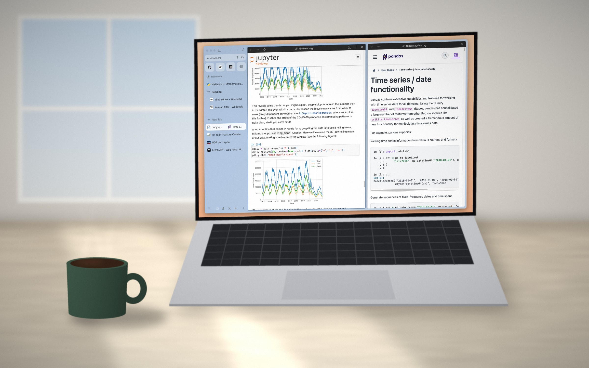
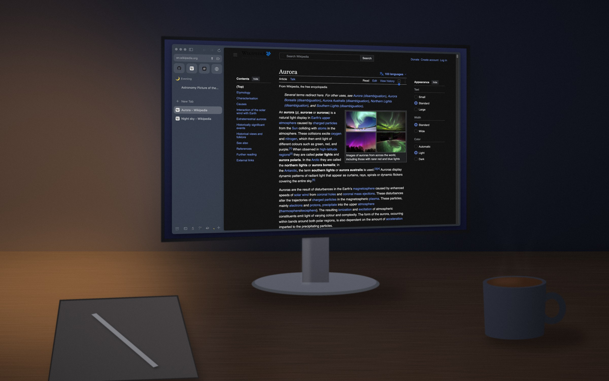

<h1 align="center">Kite</h1>

<p align="center">
  <b>A calm, keyboard-first browser for people who spend the day in one.</b><br>
  Spaces, split view and Peeks on Chromium, with a seat for your agents.
</p>

<p align="center">
  <a href="https://github.com/gabekus/kite/releases/latest/download/Kite.zip">
    
  </a>
  <br>
  <sub>Apple Silicon · signed and notarized · updates itself · <a href="https://github.com/gabekus/kite/releases">all releases</a></sub>
</p>

<p align="center">
  <picture>
    <source media="(prefers-color-scheme: dark)" srcset="media/hero-dark.png">
    <source media="(prefers-color-scheme: light)" srcset="media/hero-light.png">
    
  </picture>
</p>

## Why

A working day in data is a notebook, the docs for the thing in the notebook, three dashboards, a pull request,
and an agent or two looking things up. Most browsers answer that with a row of forty tabs.

Kite keeps the parts of Arc that fixed this and builds on them: a sidebar instead of a tab strip, a space for
each project, tabs that put themselves away, and two pages side by side when you need them. It runs on
Chromium, so every site and DevTools work as you expect. There is no account to make, and it's quiet about
what it sends.

## What's in it

### A space for each project

Each space has its own pinned tabs, folders, colors and icon, and can have its own profile: separate cookies
and logins, so the staging account and the production account stop tripping over each other. Switch with
<kbd>⌃1</kbd>–<kbd>⌃9</kbd>, <kbd>⌥⌘←</kbd> <kbd>⌥⌘→</kbd>, or a two-finger swipe on the sidebar.

<p align="center">
  
</p>

### Split view, Peeks and the command bar

<p align="center">
  <a href="media/kite-flow.mp4">
    
  </a>
  <br>
  <sub>A real recording, 19 seconds. <a href="media/kite-flow.mp4">Watch it as video</a>.</sub>
</p>

- **Split view.** <kbd>⌘L</kbd> puts a second page beside the one you're on, up to four panes, side by side
  or stacked. Drag the divider to resize. A split is one row in the sidebar, so the notebook and its docs
  stay together.
- **Peek.** <kbd>⇧</kbd>-click any link and it opens in a card over the page. Read it, press
  <kbd>Esc</kbd>, and you're back where you were, or keep it as a tab or a split pane. Links to other sites
  from your pinned tabs open this way too.
- **Command bar.** <kbd>⌘T</kbd> takes a URL, a search, the name of a tab you already have open, something
  from your history, or any menu command. Type a site and press <kbd>Tab</kbd> to search inside it.
- **Auto-archive.** Unpinned tabs you haven't touched in 12 hours move to the Archive. Pinned tabs stay.
  The time is yours to set, from an hour to never, and an archived tab is one click from coming back.

<table>
  <tr>
    <td width="50%"></td>
    <td width="50%"></td>
  </tr>
  <tr>
    <td align="center"><sub>⌘T finds the tab you already have</sub></td>
    <td align="center"><sub>A Peek over the page you were reading</sub></td>
  </tr>
</table>

### Ads and click-hijacks, blocked

Kite blocks ads and trackers out of the box with Brave's `adblock-rust` engine and the EasyList, EasyPrivacy
and uBlock Origin filter lists. It also stops the trick filter lists can't name: a page that opens some other
site in a new tab when you click anywhere on it. <kbd>⌥⌘B</kbd> turns blocking off for a site that needs it.

### Chromium underneath

Chromium 156, through [CEF](https://github.com/chromiumembedded/cef), with its sandbox on. DevTools is
<kbd>⌥⌘I</kbd>. Start Kite with `KITE_REMOTE_DEBUGGING_PORT=9222` and it speaks the Chrome DevTools Protocol,
for Playwright, Puppeteer or your own tooling. Extensions install from the Chrome Web Store (Manifest V3).

## Agents in your browser

Kite ships an [MCP](https://modelcontextprotocol.io) server and a `kite` command line tool. An agent such as
Claude Code works in your real browser, in tabs you can see, and keeps its work out of your way: its tabs go
in a **Claude folder** inside the space they belong to, one folder per session, and an idle session archives
itself like any other tab.

<p align="center">
  <a href="media/kite-agents.mp4">
    
  </a>
  <br>
  <sub>An agent session filing its own tabs. <a href="media/kite-agents.mp4">Watch it as video</a>.</sub>
</p>

Connect it from **Kite › Connect Claude…**, or by hand:

```bash
claude mcp add -s user kite -- /Applications/Kite.app/Contents/Helpers/kite mcp
```

Then turn on **Kite › Allow Claude to Control the Browser**. It's off until you do.

| | Tools |
|---|---|
| Tabs and spaces | `tabs_context` `tabs_create` `switch_tab` `list_spaces` `create_space` `pin_tab` `move_to_folder` |
| On screen | `split_view` `peek` `caption` `record` |
| Pages | `read_page` `find` `click` `type` `form_input` `screenshot` `javascript` `wait_for` |
| Debugging | `read_console_messages` `network_log` `network_request` `export_har` |
| Handing over | `handoff` `handoff_status` `sign_in` `tab_status` |

A few things it's careful about:

- **You can see it.** A tab an agent is working in gets an orange border and a line in the sidebar saying
  what it's doing there, and a dot when it's done.
- **Your screen is yours.** Tools work on background tabs. Changing the tab in front, its split or a Peek
  takes an explicit `active: true`, for when you asked.
- **Hand-offs happen on the page.** When a step is yours (a sign-in, a payment, a choice), `handoff` rings
  the exact control in orange with the step beside it, and the agent carries on when you've clicked it.
  `sign_in` leaves passwords to you and your password manager; the agent never sees them.
- **Pages are data.** Everything read from a page reaches the agent marked as untrusted content, not as
  instructions.
- **Ask first, if you like.** Kite › Ask Before Claude Acts has Kite check with you before an agent
  submits, sends, pays or deletes. It's optional and off by default.

<p align="center">
  
</p>

## Through the day

<p align="center">
  
</p>

<table>
  <tr>
    <td width="50%"></td>
    <td width="50%"></td>
  </tr>
  <tr>
    <td align="center"><sub>The afternoon's notebook, by the window</sub></td>
    <td align="center"><sub>A dark space for after hours</sub></td>
  </tr>
</table>

<p align="center"><sub>The desks are drawn. Every window on a screen is a real capture of Kite, on a fresh profile with public pages.</sub></p>

## Shortcuts

| | |
|---|---|
| <kbd>⌘T</kbd> | Command bar: open, search, switch to a tab, run a command |
| <kbd>⌘L</kbd> | Add a split view |
| <kbd>⇧</kbd> click | Open a link in a Peek |
| <kbd>⌘S</kbd> | Hide or show the sidebar |
| <kbd>⌃1</kbd>–<kbd>⌃9</kbd> · <kbd>⌥⌘←</kbd> <kbd>⌥⌘→</kbd> | Go to a space · previous and next space |
| <kbd>⌃Tab</kbd> | Switch between recent tabs |
| <kbd>⌘1</kbd>–<kbd>⌘9</kbd> · <kbd>⌥⌘↑</kbd> <kbd>⌥⌘↓</kbd> | Go to a tab · previous and next tab |
| <kbd>⌘D</kbd> | Pin the tab |
| <kbd>⌘W</kbd> · <kbd>⇧⌘T</kbd> | Archive the tab · bring the last one back |
| <kbd>⇧⌘C</kbd> · <kbd>⌥⇧⌘C</kbd> | Copy the URL · copy it as a Markdown link |
| <kbd>⌥⌘N</kbd> | Little Kite: a small window for one quick page |
| <kbd>⇧⌘L</kbd> · <kbd>⌘Y</kbd> | Library (archive, downloads) · history |
| <kbd>⌥⌘I</kbd> · <kbd>⌥⌘J</kbd> | Developer Tools · JavaScript console |
| <kbd>⌥⌘B</kbd> | Block ads on this site, on or off |
| <kbd>⌘J</kbd> | Ask Claude |

The full list is in **Help › Essential Keyboard Shortcuts** and the menus.

## Install and update

1. [Download Kite.zip](https://github.com/gabekus/kite/releases/latest/download/Kite.zip) and unzip it.
2. Drag Kite.app to Applications and open it.

Kite needs macOS 14 or later on Apple Silicon. It's signed with a Developer ID and notarized by Apple, so it
opens like any Mac app. After that it updates itself with [Sparkle](https://sparkle-project.org): it checks
this repository's feed every eight hours, verifies the update's signature before unpacking it, and installs
when you quit. **Kite › Check for Updates…** does it now.

Coming from another browser? **Kite › Import from Another Browser…** brings bookmarks and history, and
**File › Import from Arc…** brings spaces, pinned tabs, folders, favorites and themes.

## Privacy

Kite has no account, and no telemetry, analytics or crash reporting. Your tabs, history and settings stay in
its folder on your Mac.

What Kite itself does send:

- **Update checks** to this repository on GitHub.
- **Filter lists** for the ad blocker, downloaded from their publishers and refreshed daily.
- **Search suggestions**, to the search engine you chose, as you type in the command bar. They go without
  cookies and can be turned off per profile.
- **Site icons**, fetched from the sites in your sidebar.
- **Chromium's own component updates**, such as the Widevine module, from Google.
- **What you ask Claude to work on.** Kite has no model or API key of its own. Its Claude features (⌘J, and
  the Max features: Tidy Tabs, Tidy Tab Titles, Tidy Downloads, Instant Links) run through the Claude Code
  command line tool on your Mac, under your own login, and send Claude what they work on, such as a tab's
  title or a download's name and site. Some of these are on by default; each has a switch in the Kite menu
  and Settings › Max.

Agents reach Kite over a local socket on your Mac, only after you allow it. The DevTools Protocol port is
closed unless you start Kite with it.

## Status

Kite is a working name, and it's early. It's used every day, and it still changes fast.

| | |
|---|---|
| Spaces, profiles, pinned tabs and folders, favorites, themes | Working |
| Command bar, split view, Peeks, auto-archive, Little Kite, incognito | Working |
| Ad and tracker blocking, click-hijack guard | Working; no button yet to allow a popup it blocked |
| MCP server, `kite` CLI, Claude folders, hand-offs, recording | Working, and changing most often |
| Chrome Web Store extensions | Install and run; some toolbar popups and extension APIs are missing |
| Passkeys | From a phone (QR) or 1Password; not iCloud Keychain yet |
| Sync between Macs, sharing a space | Not yet |
| Translation, notes | Not yet |
| Intel Macs | Not supported |
| Windows | In progress. An unsigned [preview](https://github.com/gabekus/kite/releases/tag/windows-preview) exists; it's behind the Mac version and doesn't update itself |

## Links

- [Latest release](https://github.com/gabekus/kite/releases/latest) and [all releases](https://github.com/gabekus/kite/releases)
- [Setup guide for Claude Code](https://github.com/gabekus/kite/releases/latest/download/SETUP.md), the one `kite setup` walks through
- [Windows preview](https://github.com/gabekus/kite/releases/tag/windows-preview)
- [Issues](https://github.com/gabekus/kite/issues), for bugs and requests

This repository holds Kite's releases, its update feed and this page. Kite's source is closed.

## License

Kite is proprietary software, © 2026 Gabe Kuslansky, all rights reserved. It includes open-source components
under their own licenses (Chromium and CEF, Sparkle, adblock-rust and others); their notices ship inside the
app, in `Kite.app/Contents/Resources/THIRD_PARTY_NOTICES.md`.
